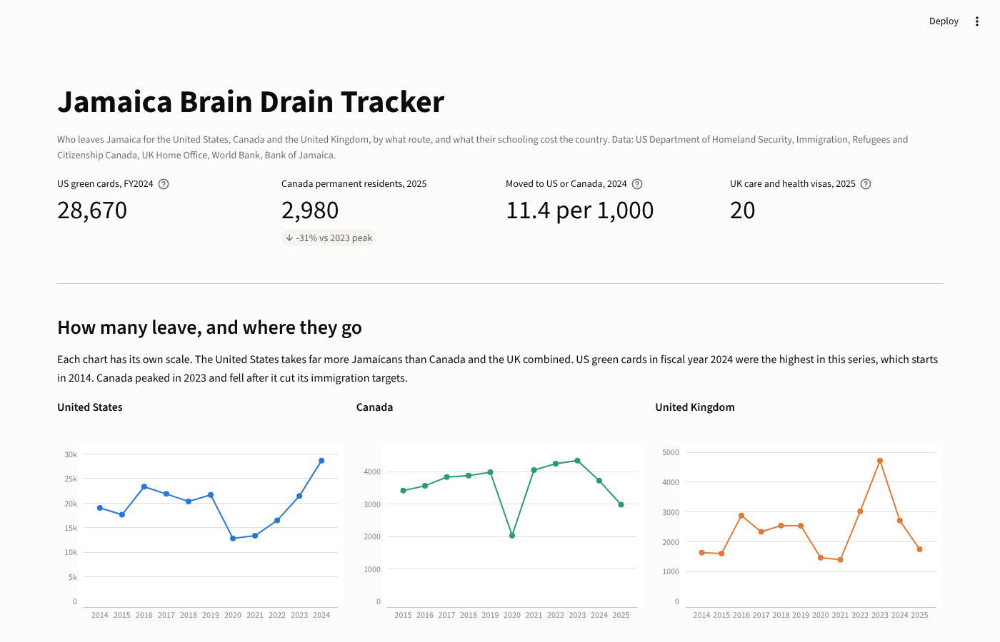

# Jamaica brain drain tracker

Who leaves Jamaica for the United States, Canada and the United Kingdom, by what route,
and what their schooling cost the country, set against the remittances the diaspora
sends home.

**Live app: https://jamaica-brain-drain.streamlit.app**



## The short version

| | |
|---|---|
| US green cards, people born in Jamaica, FY2024 | 28,670, the highest since the series here starts in 2014 |
| Canada permanent residents, Jamaican citizens, 2025 | 2,980, down 31% from 4,340 in 2023 |
| Moved to the US or Canada in 2024 | 32,390, or 11.4 for every 1,000 people in Jamaica |
| US green cards that came through a job, 2015 to 2024 | 4.4% |
| Canada admissions through economic (work) programs, 2015 to 2024 | 36.2% |
| UK Health and Care Worker visas, Jamaican main applicants | 5 in 2020, 693 in 2023, 20 in 2025 |
| Public schooling carried by 2024's movers (default assumptions) | about US$559m, about 17% of 2024 remittances |

## Findings

1. **The United States dominates.** It takes far more Jamaicans than Canada and the UK
   combined. FY2024 was the highest year in this series.
2. **Most people leave to join family, not for a job.** Only 4.4% of US green cards for
   Jamaicans came through employment. Canada's work programs matter more (36%), but family
   sponsorship is still the largest route. Family migrants include nurses, teachers and
   graduates, but none of these sources records their jobs.
3. **Destination policy drives the numbers.** Canada's arrivals fell after it cut its
   permanent resident targets for 2025 to 2027. In the UK, Health and Care Worker visas for
   Jamaicans rose from 5 to 693 in three years, then collapsed after the UK banned new care
   workers from bringing dependants (March 2024) and closed overseas recruitment of care
   workers (22 July 2025).
4. **The schooling cost is real but smaller than remittances.** With the default assumptions
   (70% finished school in Jamaica, 20% of those with a degree), 2024's movers took about
   US$559m of public education with them, against US$3.36bn of remittances that year.
   Remittances come from a diaspora built over decades, so this compares a one year loss
   with a yearly return on a much larger stock. The app lets you change the assumptions.

## Data

| Series | Source | Coverage |
|---|---|---|
| Green cards by class of admission, people born in Jamaica | US DHS Yearbook of Immigration Statistics, Table 10 | FY2014 to FY2024 |
| Permanent residents by category, Jamaican citizens | IRCC open data (EN_ODP-PR-Citz, EN_ODP-PR-CitzImmCat) | Jan 2015 to Sep 2026 |
| Entry clearance visas issued, Jamaican nationals | UK Home Office, Vis_D02, year ending June 2026 | 2005 to Jun 2026 |
| GDP per person, spending per student, population | World Bank WDI | 2000 to 2025 |
| Remittance inflows by source country | Bank of Jamaica, ES.RMT.01 | 2012 to Aug 2026 |

Every series was checked against the source's own totals: Canada's monthly figures sum to
IRCC's annual totals (within IRCC's rounding to 5), Canada's categories sum to its country
total, the UK visa groups sum to the Jamaican total for every year, and US values match the
published DHS tables.

## Limits

* These are counts of people granted status in a year. Many were already living abroad,
  for example as students or temporary workers.
* Most records have no occupation, so the skills story leans on visa routes and the UK
  health and care data.
* US figures are fiscal years (October to September). Canada and the UK are calendar years.
* The schooling estimate uses today's GDP per person and the latest World Bank spending
  shares (2018 for primary and secondary, 2015 for tertiary). It is an illustration,
  not a full cost benefit study.

## Run it

```bash
pip install -r requirements.txt
python src/analysis.py   # rebuilds outputs/ from data/raw
streamlit run app.py
```

## Related

* [Jamaica remittances tracker and forecast](https://github.com/Soulkinggja/jamaica-remittances)
  and the working paper [Diaspora as Insurance](https://doi.org/10.5281/zenodo.24473011).

Built by Devin McIntosh.
